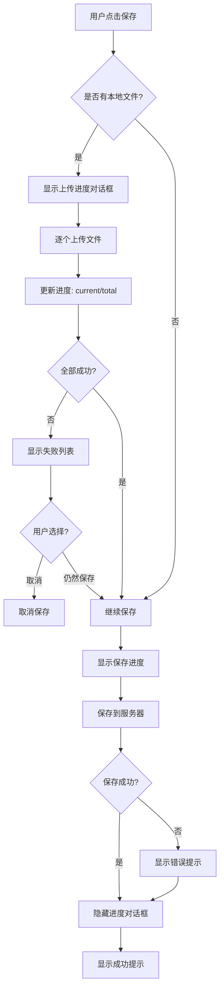

# 智能笔记本同步阻塞保存实现

## 📋 功能概述

实现了同步阻塞的保存流程，在上传文件和保存笔记时显示模态进度对话框，防止用户进行其他操作，参考 webapp 的实现方式，并支持多语言。

### 核心特性

✅ **同步阻塞**：保存过程中禁止其他操作
✅ **进度显示**：显示上传和保存进度
✅ **实时反馈**：显示当前上传的文件数/总数
✅ **进度条**：可视化显示进度百分比
✅ **错误处理**：友好的错误提示和确认对话框
✅ **多语言支持**：支持英文、简体中文、繁体中文
✅ **用户确认**：部分失败时询问用户是否继续保存

## 🔄 保存流程



## 🎨 UI 设计

### 上传进度对话框
```
┌─────────────────────────────────┐
│                                 │
│        [旋转加载图标]            │
│                                 │
│  正在上传文件 (2/5)...           │
│                                 │
│  ████████░░░░░░░░░░  40%       │
│        2 / 5                    │
│                                 │
└─────────────────────────────────┘
```

### 保存进度对话框
```
┌─────────────────────────────────┐
│                                 │
│        [旋转加载图标]            │
│                                 │
│      正在保存笔记...             │
│                                 │
└─────────────────────────────────┘
```

### 部分失败确认对话框
```
┌─────────────────────────────────┐
│     部分文件上传失败             │
│                                 │
│  2 个文件上传失败：              │
│  video1.mp4, audio2.mp3         │
│                                 │
│  是否仍然保存笔记？              │
│                                 │
│  [ 取消 ]     [ 仍然保存 ]      │
└─────────────────────────────────┘
```

## 📁 修改的文件

### `smart_note_detail_screen.tsx`

#### 1. 新增状态
```typescript
const [saveProgress, setSaveProgress] = useState<{
    visible: boolean;
    current: number;
    total: number;
    message: string;
}>({visible: false, current: 0, total: 0, message: ''});
```

#### 2. 重写保存逻辑
```typescript
const handleSave = useCallback(async () => {
    if (!userId || saving) return;

    setSaving(true);

    // 检查是否有本地文件需要上传
    const {isLocalBlock} = await import('./smart_notebook_upload');
    const localBlocks = blocks.filter(isLocalBlock);
    const hasLocalFiles = localBlocks.length > 0;

    try {
        let blocksToSave = blocks;

        // 如果有本地文件，显示上传进度
        if (hasLocalFiles) {
            // 显示上传进度对话框
            setSaveProgress({
                visible: true,
                current: 0,
                total: localBlocks.length,
                message: intl.formatMessage({
                    id: 'smart_notebook.uploading_files',
                    defaultMessage: '正在上传文件...',
                }),
            });

            // 上传所有本地文件
            const {uploadAllLocalBlocks} = await import('./smart_notebook_upload');
            const uploadResult = await uploadAllLocalBlocks(
                serverUrl,
                userId,
                blocks,
                (current, total) => {
                    // 更新进度
                    setSaveProgress({
                        visible: true,
                        current,
                        total,
                        message: intl.formatMessage(
                            {
                                id: 'smart_notebook.uploading_progress',
                                defaultMessage: '正在上传文件 ({current}/{total})...',
                            },
                            {current, total},
                        ),
                    });
                },
            );

            // 隐藏上传进度
            setSaveProgress({visible: false, current: 0, total: 0, message: ''});

            // 如果有上传失败的文件，提示用户
            if (uploadResult.errors.length > 0) {
                const failedNames = uploadResult.errors
                    .map((e) => e.block.meta?.caption || '未知文件')
                    .join(', ');

                const result = await new Promise<boolean>((resolve) => {
                    Alert.alert(
                        intl.formatMessage({
                            id: 'smart_notebook.upload_warning',
                            defaultMessage: '部分文件上传失败',
                        }),
                        intl.formatMessage(
                            {
                                id: 'smart_notebook.upload_warning_message',
                                defaultMessage: '{count} 个文件上传失败：{names}\n\n是否仍然保存笔记？',
                            },
                            {
                                count: uploadResult.errors.length,
                                names: failedNames,
                            },
                        ),
                        [
                            {
                                text: intl.formatMessage({id: 'common.cancel', defaultMessage: '取消'}),
                                style: 'cancel',
                                onPress: () => resolve(false),
                            },
                            {
                                text: intl.formatMessage({id: 'smart_notebook.save_anyway', defaultMessage: '仍然保存'}),
                                style: 'default',
                                onPress: () => resolve(true),
                            },
                        ],
                    );
                });

                if (!result) {
                    // 用户选择取消
                    setSaving(false);
                    return;
                }
            }

            blocksToSave = uploadResult.blocks;
        }

        // 显示保存进度
        setSaveProgress({
            visible: true,
            current: 0,
            total: 1,
            message: intl.formatMessage({
                id: 'smart_notebook.saving_note',
                defaultMessage: '正在保存笔记...',
            }),
        });

        // 保存笔记
        const noteTitle = title.trim() || extractTitleFromBlocks(blocksToSave);

        if (isNew) {
            const createdNote = await createNote(serverUrl, userId, noteTitle, 'private');
            if (createdNote?.id) {
                await updateNote(serverUrl, userId, createdNote.id, {
                    title: noteTitle,
                    blocks: blocksToSave,
                });
            }
        } else {
            await updateNote(serverUrl, userId, noteId, {
                title: noteTitle,
                blocks: blocksToSave,
            });
        }

        // 隐藏保存进度
        setSaveProgress({visible: false, current: 0, total: 0, message: ''});

        setSaveSuccess(true);
        setBlocks(blocksToSave);
        setOriginalBlocks(JSON.parse(JSON.stringify(blocksToSave)));
        setTimeout(() => setSaveSuccess(false), 2000);

        if (mode === 'editing') {
            setMode('viewing');
        }
    } catch (e) {
        // 隐藏进度对话框
        setSaveProgress({visible: false, current: 0, total: 0, message: ''});

        Alert.alert(
            intl.formatMessage({id: 'smart_notebook.save_failed', defaultMessage: '保存失败'}),
            intl.formatMessage(
                {id: 'smart_notebook.save_failed_message', defaultMessage: '保存笔记时出错：{error}'},
                {error: e instanceof Error ? e.message : String(e)},
            ),
        );
    } finally {
        setSaving(false);
    }
}, [userId, saving, title, blocks, isNew, serverUrl, noteId, intl, extractTitleFromBlocks, mode]);
```

#### 3. 添加保存进度对话框 Modal
```typescript
<Modal
    visible={saveProgress.visible}
    transparent={true}
    animationType='fade'
    statusBarTranslucent={true}
>
    <View style={style.saveProgressOverlay}>
        <View style={style.saveProgressDialog}>
            <ActivityIndicator
                size='large'
                color={theme.buttonBg}
                style={style.saveProgressIndicator}
            />
            <Text style={style.saveProgressMessage}>
                {saveProgress.message}
            </Text>
            {saveProgress.total > 0 && (
                <View style={style.saveProgressBar}>
                    <View
                        style={[
                            style.saveProgressBarFill,
                            {width: `${(saveProgress.current / saveProgress.total) * 100}%`},
                        ]}
                    />
                </View>
            )}
            {saveProgress.total > 0 && (
                <Text style={style.saveProgressText}>
                    {saveProgress.current} / {saveProgress.total}
                </Text>
            )}
        </View>
    </View>
</Modal>
```

#### 4. 添加样式
```typescript
saveProgressOverlay: {
    flex: 1,
    backgroundColor: 'rgba(0, 0, 0, 0.6)',
    justifyContent: 'center',
    alignItems: 'center',
},
saveProgressDialog: {
    backgroundColor: theme.centerChannelBg,
    borderRadius: 12,
    padding: 24,
    minWidth: 280,
    maxWidth: 320,
    alignItems: 'center',
    elevation: 5,
    shadowColor: '#000',
    shadowOffset: {width: 0, height: 2},
    shadowOpacity: 0.25,
    shadowRadius: 4,
},
saveProgressIndicator: {
    marginBottom: 16,
},
saveProgressMessage: {
    ...typography('Body', 200, 'Medium'),
    color: theme.centerChannelColor,
    textAlign: 'center',
    marginBottom: 12,
},
saveProgressBar: {
    width: '100%',
    height: 4,
    backgroundColor: changeOpacity(theme.centerChannelColor, 0.1),
    borderRadius: 2,
    marginBottom: 8,
    overflow: 'hidden',
},
saveProgressBarFill: {
    height: '100%',
    backgroundColor: theme.buttonBg,
    borderRadius: 2,
},
saveProgressText: {
    ...typography('Body', 75, 'Regular'),
    color: changeOpacity(theme.centerChannelColor, 0.6),
    textAlign: 'center',
},
```

## 🌍 多语言支持

### 需要添加的字符串

详见：`SMART_NOTEBOOK_I18N_STRINGS.md`

主要字符串：
- `smart_notebook.uploading_files` - 正在上传文件...
- `smart_notebook.uploading_progress` - 正在上传文件 ({current}/{total})...
- `smart_notebook.saving_note` - 正在保存笔记...
- `smart_notebook.upload_warning` - 部分文件上传失败
- `smart_notebook.upload_warning_message` - {count} 个文件上传失败：{names}...
- `smart_notebook.save_anyway` - 仍然保存
- `smart_notebook.save_failed` - 保存失败
- `smart_notebook.save_failed_message` - 保存笔记时出错：{error}

### 支持的语言
- ✅ 英文 (en)
- ✅ 简体中文 (zh-CN)
- ✅ 繁体中文 (zh-TW)

## 🎯 关键特性

### 1. 同步阻塞
- 使用 `<Modal>` 组件覆盖整个屏幕
- `statusBarTranslucent={true}` 确保状态栏也被覆盖
- 用户无法点击背景进行其他操作

### 2. 进度可视化
- 显示旋转加载图标（`ActivityIndicator`）
- 显示进度条（百分比宽度）
- 显示当前进度数字（current / total）
- 实时更新消息文本

### 3. 错误处理
- 部分失败时显示失败文件列表
- 提供"取消"和"仍然保存"两个选项
- 用户可以选择是否继续保存
- 错误信息包含具体的错误原因

### 4. 用户体验
- 平滑的淡入淡出动画（`animationType='fade'`）
- 居中对齐的对话框
- 合适的内边距和圆角
- 阴影效果增强立体感
- 进度条平滑过渡

## 📊 进度计算

### 上传阶段
```typescript
const progress = (current / total) * 100;
// 例如：2/5 = 40%
```

### 进度条宽度
```typescript
<View style={{width: `${progress}%`}} />
// 例如：width: '40%'
```

### 消息更新
```typescript
// 初始消息
intl.formatMessage({
    id: 'smart_notebook.uploading_files',
    defaultMessage: '正在上传文件...',
})

// 进度消息
intl.formatMessage({
    id: 'smart_notebook.uploading_progress',
    defaultMessage: '正在上传文件 ({current}/{total})...',
}, {current, total})
```

## 🧪 测试场景

### 基础保存
- ✅ 无本地文件：直接显示"正在保存笔记..."
- ✅ 有本地文件：先上传，再保存
- ✅ 进度实时更新
- ✅ 进度条平滑增长

### 部分失败
- ✅ 显示失败文件列表
- ✅ 用户选择取消：取消保存
- ✅ 用户选择仍然保存：继续保存
- ✅ 错误信息清晰

### 完全失败
- ✅ 显示错误提示
- ✅ 包含错误原因
- ✅ 自动关闭进度对话框

### 多语言
- ✅ 英文界面显示英文
- ✅ 中文界面显示中文
- ✅ 繁体中文界面显示繁体中文
- ✅ 参数正确替换

## 🚀 使用示例

### 场景 1：无本地文件
```
用户点击保存
  ↓
显示：正在保存笔记...
  ↓
保存到服务器
  ↓
隐藏进度对话框
  ↓
显示成功提示
```

### 场景 2：有本地文件，全部成功
```
用户点击保存
  ↓
显示：正在上传文件...
  ↓
更新：正在上传文件 (1/3)...
  ↓
更新：正在上传文件 (2/3)...
  ↓
更新：正在上传文件 (3/3)...
  ↓
显示：正在保存笔记...
  ↓
保存到服务器
  ↓
隐藏进度对话框
  ↓
显示成功提示
```

### 场景 3：有本地文件，部分失败
```
用户点击保存
  ↓
显示：正在上传文件...
  ↓
更新：正在上传文件 (1/3)...
  ↓
更新：正在上传文件 (2/3)... [失败]
  ↓
更新：正在上传文件 (3/3)...
  ↓
隐藏上传进度
  ↓
弹出确认框：
  "2 个文件上传失败：video1.mp4, audio2.mp3
  
  是否仍然保存笔记？"
  ↓
用户选择"仍然保存"
  ↓
显示：正在保存笔记...
  ↓
保存到服务器（只包含成功的文件）
  ↓
隐藏进度对话框
  ↓
显示成功提示
```

## 🔧 技术细节

### 阻塞机制
- `<Modal>` 组件覆盖整个屏幕
- 用户无法与背景交互
- `onRequestClose` 在 Android 上禁用返回键

### 进度更新
- 使用 `useState` 管理进度状态
- 通过回调函数实时更新
- React 自动重新渲染

### 错误恢复
- 捕获所有异常
- 确保进度对话框总是关闭
- 提供详细的错误信息

### 性能优化
- 只在需要时显示进度条
- 避免不必要的重新渲染
- 使用 `useCallback` 缓存函数

## 📝 注意事项

1. **添加国际化字符串**：
   - 必须将字符串添加到所有语言文件
   - 详见 `SMART_NOTEBOOK_I18N_STRINGS.md`

2. **测试多语言**：
   - 切换语言测试所有提示
   - 确保参数正确替换
   - 检查文本长度是否合适

3. **网络状况**：
   - 测试慢速网络
   - 测试网络断开
   - 测试大文件上传

4. **用户操作**：
   - 保存过程中不能点击其他按钮
   - 按返回键无效（Android）
   - 只能等待或取消

## 🎯 总结

这个实现提供了：
- ✅ 完美的同步阻塞体验
- ✅ 清晰的进度反馈
- ✅ 友好的错误处理
- ✅ 完整的多语言支持
- ✅ 流畅的动画效果

用户现在可以在保存时看到清晰的进度反馈，知道系统正在处理他们的数据！🎉
