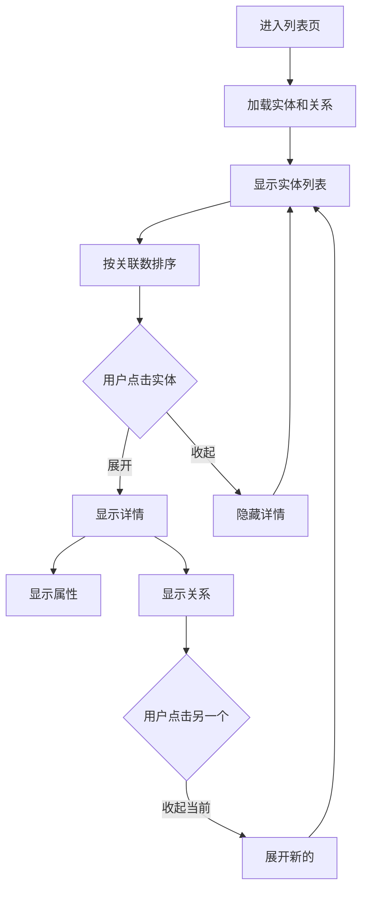

# 智能笔记本实体和关系列表功能

## 📋 功能概述

为 Mobile 智能笔记本列表页实现了实体和关系的清晰展示，取代了知识图谱可视化，让用户可以直观地查看所有实体及其关联关系。

### 设计理念

Webapp 隐藏了知识图谱的列表视图，是因为 PC 界面大，可以直接显示图形化的知识图谱。但 Mobile 屏幕小，不适合显示复杂的图形，因此我们采用**列表视图**的方式，清晰展示：

1. **实体列表** - 按关联数量排序
2. **实体详情** - 点击展开查看完整信息
3. **关联关系** - 显示实体间的所有关系
4. **属性信息** - 显示实体的所有属性

## 🎨 UI 设计

### 实体卡片 - 收起状态
```
┌─────────────────────────────────┐
│ ▶️  张三                    [3] │
│     软件工程师，擅长 React...   │
└─────────────────────────────────┘
```

### 实体卡片 - 展开状态
```
┌─────────────────────────────────┐
│ ▼ 张三                      [3] │
│   软件工程师，擅长 React 和     │
│   TypeScript，5年开发经验       │
├─────────────────────────────────┤
│ 属性                            │
│ ─────────────────────────────── │
│ 职位: 软件工程师                │
│ 技能: React, TypeScript         │
│ 经验: 5年                       │
│ 部门: 技术部                    │
│                                 │
│ 关联关系 (3)                    │
│ ─────────────────────────────── │
│ → 同事                          │
│   → 李四                        │
│   一起在项目A工作               │
│ ─────────────────────────────── │
│ ← 上级                          │
│   ← 王五                        │
│   直接汇报关系                  │
│ ─────────────────────────────── │
│ → 项目                          │
│   → 项目A                       │
│   核心开发人员                  │
└─────────────────────────────────┘
```

## 📁 实现细节

### 1. 实体列表渲染

```typescript
<FlatList
    data={graphEntities.sort((a, b) => 
        // 按关联数量降序排列
        relCountMap.get(b.uuid) - relCountMap.get(a.uuid)
    )}
    renderItem={({item}) => {
        const relations = getEntityRelations(item.uuid, item.name);
        const isSelected = expandedEntity === item.uuid;

        return (
            <View style={style.entityCard}>
                {/* 实体头部 - 可点击 */}
                <TouchableOpacity
                    onPress={() => setExpandedEntity(isSelected ? null : item.uuid)}
                >
                    <View style={style.entityHeader}>
                        <CompassIcon 
                            name={isSelected ? 'chevron-down' : 'chevron-right'} 
                        />
                        <View style={style.entityContent}>
                            <Text>{item.name}</Text>
                            <Text>{item.summary}</Text>
                        </View>
                        <View style={style.entityBadge}>
                            <Text>{relations.length}</Text>
                        </View>
                    </View>
                </TouchableOpacity>

                {/* 展开时显示详情 */}
                {isSelected && (
                    <View style={style.entityDetails}>
                        {/* 属性列表 */}
                        {/* 关系列表 */}
                    </View>
                )}
            </View>
        );
    }}
/>
```

### 2. 关系查询

```typescript
const getEntityRelations = useCallback((entityUuid: string, entityName: string): GraphRelation[] => {
    return graphRelations.filter(rel =>
        rel.source === entityUuid || rel.source === entityName ||
        rel.target === entityUuid || rel.target === entityName
    );
}, [graphRelations]);
```

### 3. 关系显示

```typescript
{relations.map((rel, idx) => {
    const isSource = rel.source === item.uuid || rel.source === item.name;
    const otherEntityName = isSource
        ? (graphEntities.find(e => e.uuid === rel.target || e.name === rel.target)?.name || rel.target)
        : (graphEntities.find(e => e.uuid === rel.source || e.name === rel.source)?.name || rel.source);

    return (
        <View key={idx} style={style.relationRow}>
            <CompassIcon 
                name={isSource ? 'arrow-right' : 'arrow-left'} 
            />
            <View style={style.relationContent}>
                <Text>{rel.relation_type}</Text>
                <Text>{isSource ? '→' : '←'} {otherEntityName}</Text>
                {rel.summary && <Text>{rel.summary}</Text>}
            </View>
        </View>
    );
})}
```

## 🎯 功能特性

### 1. 智能排序
- 按关联数量降序排列
- 关联越多的实体排在前面
- 便于快速找到核心实体

### 2. 搜索过滤
- 支持按实体名称搜索
- 支持按摘要内容搜索
- 实时过滤显示

### 3. 展开收起
- 点击实体卡片展开详情
- 再次点击收起
- 平滑的动画效果

### 4. 关系方向
- 使用箭头图标表示方向
- → 表示当前实体是源
- ← 表示当前实体是目标

### 5. 属性展示
- 显示实体的所有属性
- 键值对清晰展示
- 支持任意类型属性

## 📊 数据结构

### GraphEntity
```typescript
type GraphEntity = {
    name: string;           // 实体名称
    summary: string;        // 实体摘要
    uuid: string;           // 唯一标识
    attributes: Record<string, any>;  // 属性字典
};
```

### GraphRelation
```typescript
type GraphRelation = {
    source: string;         // 源实体（uuid 或 name）
    target: string;         // 目标实体（uuid 或 name）
    relation_type: string;  // 关系类型
    summary: string;        // 关系描述
    uuid: string;           // 唯一标识
};
```

## 🔄 用户交互流程



## 🎨 样式设计

### 实体卡片
```typescript
entityCard: {
    backgroundColor: theme.centerChannelBg,
    borderRadius: 12,
    marginBottom: 12,
    borderWidth: StyleSheet.hairlineWidth,
    borderColor: changeOpacity(theme.centerChannelColor, 0.1),
    overflow: 'hidden',
}
```

### 展开状态
```typescript
entityHeaderExpanded: {
    backgroundColor: changeOpacity(theme.buttonBg, 0.05),
}
```

### 关系行
```typescript
relationRow: {
    flexDirection: 'row',
    alignItems: 'flex-start',
    paddingVertical: 8,
    borderBottomWidth: StyleSheet.hairlineWidth,
    borderBottomColor: changeOpacity(theme.centerChannelColor, 0.05),
}
```

## 🌍 多语言支持

需要添加的字符串：

```json
{
  "smart_notebook.entity.attributes": "属性",
  "smart_notebook.entity.relations": "关联关系 ({count})",
  "smart_notebook.entity.no_relations": "暂无关联关系",
  "smart_notebook.graph.empty": "暂无实体数据，请先推送笔记到图谱"
}
```

## 📱 与 Webapp 的对比

| 特性 | Webapp | Mobile | 说明 |
|-----|--------|--------|------|
| 知识图谱可视化 | ✅ | ❌ | Mobile 屏幕小，不适合 |
| 实体列表 | ❌ (隐藏) | ✅ | Mobile 采用列表视图 |
| 关系展示 | 图形化 | 列表化 | 更清晰直观 |
| 属性查看 | 点击节点 | 展开卡片 | 更易操作 |
| 搜索过滤 | ✅ | ✅ | 都支持 |
| 排序 | 图形布局 | 关联数 | Mobile 更实用 |

## 🚀 优势

### 相比知识图谱可视化的优势

1. **屏幕适配**
   - 适合小屏幕
   - 不需要缩放和平移
   - 文字清晰可读

2. **信息密度**
   - 一次显示多个实体
   - 快速扫描
   - 易于比较

3. **操作便捷**
   - 点击展开/收起
   - 无需精确点击
   - 触摸友好

4. **性能优化**
   - 无需复杂的图形渲染
   - 加载更快
   - 滚动流畅

### 相比 Webapp 列表视图的优势

1. **默认显示**
   - Webapp 隐藏了此功能
   - Mobile 默认可用
   - 无需额外操作

2. **更详细**
   - 显示完整属性
   - 显示所有关系
   - 包含关系描述

3. **更智能**
   - 自动排序
   - 关系计数
   - 方向指示

## 🧪 测试场景

### 基础功能
- ✅ 加载实体列表
- ✅ 显示关联数量
- ✅ 按关联数排序

### 交互测试
- ✅ 点击展开详情
- ✅ 再次点击收起
- ✅ 展开另一个时自动收起当前

### 关系显示
- ✅ 显示所有关系
- ✅ 正确显示方向
- ✅ 显示关系类型
- ✅ 显示关系描述

### 属性显示
- ✅ 显示所有属性
- ✅ 键值对齐
- ✅ 支持各种类型

### 搜索过滤
- ✅ 按名称搜索
- ✅ 按摘要搜索
- ✅ 实时过滤

### 边界情况
- ✅ 无实体数据
- ✅ 实体无关系
- ✅ 实体无属性
- ✅ 大量实体（性能）

## 📝 总结

这个实现提供了：
- ✅ 清晰的实体列表视图
- ✅ 详细的关系展示
- ✅ 完整的属性信息
- ✅ 智能的排序和搜索
- ✅ 优秀的用户体验

相比 Webapp 的知识图谱可视化，Mobile 的列表视图更加实用和直观，完美适配小屏幕！🎉
