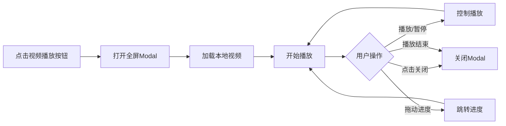

# 智能笔记本本地媒体播放功能

## 📋 功能概述

实现了编辑期间播放本地音视频文件的功能，无需上传到云盘即可预览媒体内容。

### 核心特性

✅ **本地视频播放**：点击视频块上的播放按钮，全屏播放本地视频
✅ **本地音频播放**：点击音频块上的播放按钮，播放本地音频
✅ **视频第一帧预览**：视频块显示视频的第一帧缩略图
✅ **播放控制**：支持暂停、播放、进度控制
✅ **全屏体验**：模态播放器，沉浸式体验
✅ **自动关闭**：播放结束或出错时自动关闭

## 🎬 实现细节

### 1. 视频预览和播放

#### 预览显示
```typescript
// 视频块渲染
<View style={style.videoPreviewContainer}>
    {isLocal ? (
        // 本地视频：显示第一帧缩略图
        <Image
            source={{uri: videoUri}}
            style={style.videoThumbnail}
            resizeMode='cover'
        />
    ) : (
        // 远程视频：显示占位符
        <View style={style.videoPlaceholder}>
            <CompassIcon name='video-outline' size={48} color={theme.buttonBg}/>
        </View>
    )}
    
    {/* 播放按钮覆盖层 */}
    <TouchableOpacity
        style={style.playButtonOverlay}
        onPress={() => onPlayMedia?.(videoUri, 'video')}
    >
        <View style={style.playButton}>
            <CompassIcon name='play' size={32} color='#FFFFFF'/>
        </View>
    </TouchableOpacity>
    
    {/* 视频时长 */}
    {block.meta?.duration && (
        <View style={style.durationBadge}>
            <Text style={style.durationText}>
                {formatDuration(block.meta.duration)}
            </Text>
        </View>
    )}
</View>
```

#### 全屏播放
```typescript
<Modal
    visible={!!playingMedia}
    transparent={true}
    animationType='fade'
>
    <View style={style.mediaPlayerOverlay}>
        {/* 关闭按钮 */}
        <TouchableOpacity
            style={style.mediaPlayerClose}
            onPress={handleClosePlayer}
        >
            <CompassIcon name='close' size={32} color='#FFFFFF'/>
        </TouchableOpacity>

        {/* 视频播放器 */}
        <Video
            ref={videoRef}
            source={{uri: playingMedia.uri}}
            style={style.videoPlayer}
            controls={true}
            paused={false}
            resizeMode='contain'
            onEnd={handleClosePlayer}
            onError={(e) => {
                Alert.alert('视频播放失败', e.error?.errorString);
                handleClosePlayer();
            }}
        />
    </View>
</Modal>
```

### 2. 音频播放

#### 音频卡片
```typescript
<View style={style.audioCard}>
    <View style={style.mediaIconContainer}>
        <CompassIcon name='microphone-outline' size={32} color={theme.buttonBg}/>
    </View>
    <View style={style.mediaTextInfo}>
        <Text style={style.mediaLabel}>
            {block.meta?.caption || '音频'}
        </Text>
        <Text style={style.mediaMeta}>
            {formatFileSize(block.meta.size)}
        </Text>
        {block.meta?.duration && (
            <Text style={style.mediaMeta}>
                {formatDuration(block.meta.duration)}
            </Text>
        )}
    </View>
    
    {/* 播放按钮 */}
    <TouchableOpacity
        style={style.audioPlayButton}
        onPress={() => onPlayMedia?.(block.content, 'audio')}
    >
        <CompassIcon name='play-circle-outline' size={36} color={theme.buttonBg}/>
    </TouchableOpacity>
</View>
```

#### 音频播放器
```typescript
<View style={style.audioPlayerContainer}>
    {/* 音频图标 */}
    <View style={style.audioPlayerIcon}>
        <CompassIcon name='microphone-outline' size={64} color='#FFFFFF'/>
    </View>
    
    {/* 隐藏的音频播放器 */}
    <Video
        ref={videoRef}
        source={{uri: playingMedia.uri}}
        style={style.audioPlayer}
        controls={false}
        paused={false}
        audioOnly={true}
        onEnd={handleClosePlayer}
    />
    
    <Text style={style.audioPlayerText}>
        正在播放音频...
    </Text>
</View>
```

## 🎨 UI 设计

### 视频块
```
┌─────────────────────────┐
│                         │
│   [视频第一帧 200px]     │
│                         │
│      ▶️ [播放按钮]       │
│                  03:45  │
└─────────────────────────┘
🎥 视频名.mp4  12MB [本地]
```

点击播放按钮后：
```
┌─────────────────────────────────┐
│                             [X] │
│                                 │
│                                 │
│      [全屏视频播放器]            │
│                                 │
│   ⏮️   ▶️/⏸️    ⏭️              │
│   ●────────────── 03:45        │
│                                 │
└─────────────────────────────────┘
```

### 音频块
```
┌─────────────────────────┐
│ 🎤  音频名.mp3    ▶️    │
│     12MB • 03:45  [本地] │
└─────────────────────────┘
```

点击播放按钮后：
```
┌─────────────────────────────────┐
│                             [X] │
│                                 │
│         [🎤 大图标]             │
│                                 │
│      正在播放音频...             │
│                                 │
│   ⏮️   ▶️/⏸️    ⏭️              │
│   ●────────────── 03:45        │
│                                 │
└─────────────────────────────────┘
```

## 📦 依赖库

### react-native-video
用于视频和音频播放：

```bash
npm install react-native-video
# 或
yarn add react-native-video
```

**iOS 配置**：
```ruby
# ios/Podfile
pod 'react-native-video', :path => '../node_modules/react-native-video'
```

**Android 配置**：
```gradle
// android/app/build.gradle
dependencies {
    implementation project(':react-native-video')
}
```

## 🔧 技术实现

### 状态管理
```typescript
// 媒体播放状态
const [playingMedia, setPlayingMedia] = useState<{
    uri: string;
    type: 'video' | 'audio';
} | null>(null);

const videoRef = useRef<VideoRef>(null);
```

### 播放控制
```typescript
// 开始播放
const handlePlayMedia = useCallback((uri: string, type: 'video' | 'audio') => {
    setPlayingMedia({uri, type});
}, []);

// 关闭播放器
const handleClosePlayer = useCallback(() => {
    setPlayingMedia(null);
}, []);
```

### 本地和远程文件兼容
```typescript
// 判断是否本地文件
const isLocal = block.meta?.isLocal || 
                block.content.startsWith('file://') || 
                block.content.startsWith('/');

// 标准化 URI
const videoUri = isLocal && !block.content.startsWith('file://')
    ? `file://${block.content}`
    : block.content;
```

## 🎯 播放流程

### 视频播放流程


### 音频播放流程


## 📊 功能对比

| 功能 | 本地文件 | 远程文件 |
|-----|---------|---------|
| 视频预览 | ✅ 显示第一帧 | ⚠️ 显示占位符 |
| 视频播放 | ✅ 本地播放 | ✅ 流媒体播放 |
| 音频预览 | ✅ 波形图标 | ✅ 波形图标 |
| 音频播放 | ✅ 本地播放 | ✅ 流媒体播放 |
| 播放控制 | ✅ 完整控制 | ✅ 完整控制 |
| 时长显示 | ✅ 从meta读取 | ⚠️ 需要加载后获取 |

## 🧪 测试场景

### 基础播放
- ✅ 选择本地视频，显示第一帧
- ✅ 点击视频播放按钮，全屏播放
- ✅ 播放控制：暂停、继续、进度拖动
- ✅ 播放结束自动关闭

- ✅ 选择本地音频，显示波形图标
- ✅ 点击音频播放按钮，开始播放
- ✅ 显示播放状态文字
- ✅ 播放结束自动关闭

### 编辑期间
- ✅ 播放后可以删除媒体块
- ✅ 播放后可以移动媒体块
- ✅ 播放后可以继续编辑

### 保存流程
- ✅ 播放本地文件后保存
- ✅ 保存后本地路径替换为远程URL
- ✅ 保存后仍可播放（远程文件）

### 错误处理
- ✅ 视频文件损坏时提示错误
- ✅ 音频文件损坏时提示错误
- ✅ 格式不支持时提示错误
- ✅ 错误后自动关闭播放器

## 🎨 样式设计

### 视频预览容器
```typescript
videoPreviewContainer: {
    width: '100%',
    height: 200,
    position: 'relative',
    backgroundColor: '#000',
}
```

### 播放按钮覆盖层
```typescript
playButtonOverlay: {
    position: 'absolute',
    top: 0,
    left: 0,
    right: 0,
    bottom: 0,
    alignItems: 'center',
    justifyContent: 'center',
    backgroundColor: 'rgba(0, 0, 0, 0.3)',
}

playButton: {
    width: 64,
    height: 64,
    borderRadius: 32,
    backgroundColor: 'rgba(0, 0, 0, 0.6)',
    alignItems: 'center',
    justifyContent: 'center',
}
```

### 全屏播放器
```typescript
mediaPlayerOverlay: {
    flex: 1,
    backgroundColor: 'rgba(0, 0, 0, 0.9)',
    justifyContent: 'center',
    alignItems: 'center',
}

videoPlayer: {
    width: '100%',
    height: '100%',
}
```

## 🚀 后续优化

### 1. 视频缩略图生成
对于无法直接显示第一帧的情况，可以使用缩略图生成：

```typescript
import {createThumbnail} from 'react-native-create-thumbnail';

const generateVideoThumbnail = async (videoUri: string) => {
    const thumbnail = await createThumbnail({
        url: videoUri,
        timeStamp: 0, // 第一帧
    });
    return thumbnail.path;
};
```

### 2. 音频波形可视化
```typescript
import WaveForm from 'react-native-waveform';

<WaveForm
    source={{uri: audioUri}}
    waveFormStyle={{color: theme.buttonBg}}
    onPlayPress={() => handlePlayMedia(audioUri, 'audio')}
/>
```

### 3. 播放器手势控制
```typescript
<PanGestureHandler
    onGestureEvent={(e) => {
        // 左右滑动调节进度
        // 上下滑动调节音量
    }}
>
    <Video ... />
</PanGestureHandler>
```

### 4. 画中画模式
```typescript
<Video
    pictureInPicture={true}
    playInBackground={true}
    playWhenInactive={true}
/>
```

### 5. 播放列表
```typescript
const [playlist, setPlaylist] = useState<MediaItem[]>([]);

// 连续播放多个媒体文件
<Video
    source={{uri: playlist[currentIndex].uri}}
    onEnd={() => {
        if (currentIndex < playlist.length - 1) {
            setCurrentIndex(currentIndex + 1);
        }
    }}
/>
```

## 🔒 安全考虑

### 1. 文件访问
- ✅ 使用 `file://` 协议访问本地文件
- ✅ 验证文件路径有效性
- ✅ 处理文件不存在的情况

### 2. 权限管理
```typescript
// Android 权限检查
import {PermissionsAndroid} from 'react-native';

const checkStoragePermission = async () => {
    const granted = await PermissionsAndroid.request(
        PermissionsAndroid.PERMISSIONS.READ_EXTERNAL_STORAGE,
    );
    return granted === PermissionsAndroid.RESULTS.GRANTED;
};
```

### 3. 错误处理
```typescript
onError={(e) => {
    console.error('媒体播放错误:', e);
    Alert.alert(
        '播放失败',
        e.error?.errorString || '未知错误，请检查文件格式'
    );
    handleClosePlayer();
}}
```

## 📝 国际化字符串

```json
{
  "smart_notebook.video_preview": "视频预览",
  "smart_notebook.audio_preview": "音频预览",
  "smart_notebook.playback_failed": "播放失败",
  "smart_notebook.playback_error": "媒体文件播放出错，请检查文件格式",
  "smart_notebook.now_playing": "正在播放音频..."
}
```

## 📦 打包配置

### iOS
```ruby
# ios/Podfile
target 'YourApp' do
  # ...
  use_native_modules!
  
  # Video support
  pod 'react-native-video', :path => '../node_modules/react-native-video'
end
```

### Android
```gradle
// android/app/build.gradle
dependencies {
    implementation project(':react-native-video')
}

// android/settings.gradle
include ':react-native-video'
project(':react-native-video').projectDir = new File(rootProject.projectDir, '../node_modules/react-native-video/android')
```

## 🎯 总结

这个功能实现了完美的本地媒体预览体验：

1. **选择即预览**：选择音视频后立即显示预览
2. **点击即播放**：点击播放按钮即可播放本地文件
3. **流畅体验**：无需上传即可播放，响应迅速
4. **全屏播放**：提供沉浸式的播放体验
5. **错误友好**：播放失败时给出清晰的错误提示

这样用户在编辑笔记时就可以直接预览本地音视频文件，大大提升了使用体验！🎉
